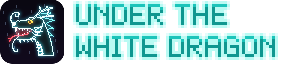
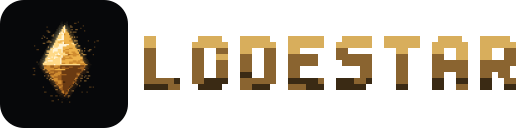
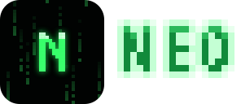
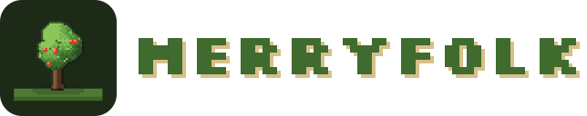
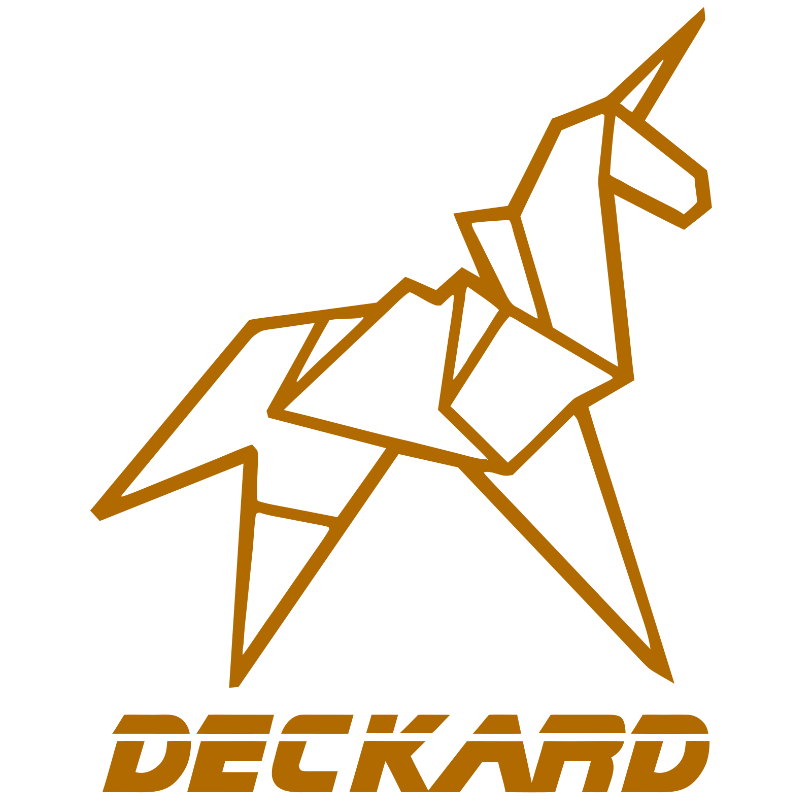
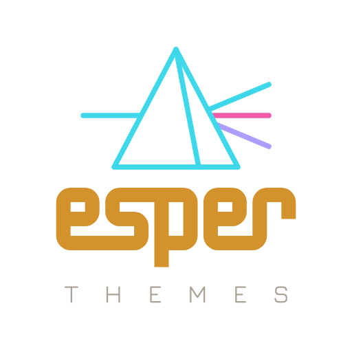

<b>David Allen</b> Software Engineer, Teacher, Hobbyist

<a href="https://davidrallen.com">davidrallen.com</a> · <a href="https://esperinnovations.com">esperinnovations.com</a>

## Games

Small pixel games for the phone browser, in plain JavaScript: no build step, no dependencies, nothing to install. Each one is a page you open and play, and each can be added to a home screen and played offline.

<table>
  <tr>
    <td width="340"><a href="https://github.com/doctorallen/under-the-white-dragon"><picture><source media="(prefers-color-scheme: dark)" srcset="brand/under-the-white-dragon-lockup.svg"></picture></a></td>
    <td>A side-scrolling cyberpunk game, held sideways. You fix what the city breaks from a hidden basement under a noodle bar: take jobs to your bench, open each machine up for real, find parts where you can, and watch your heat. The city's people have lives of their own. <b><a href="https://doctorallen.github.io/under-the-white-dragon/">Play</a></b> · <a href="https://github.com/doctorallen/under-the-white-dragon">Source</a></td>
  </tr>
  <tr>
    <td><a href="https://github.com/doctorallen/Lodestar"><picture><source media="(prefers-color-scheme: dark)" srcset="brand/lodestar-lockup.svg"></picture></a></td>
    <td>A top-down game of light and dark. A seed-star has been brought to a dead world, and you are the Kindler woken to carry its light out: one dark map, the star at the middle of it, and what lives in the dark, with your light draining as you go. <b><a href="https://doctorallen.github.io/Lodestar/">Play</a></b> · <a href="https://github.com/doctorallen/Lodestar">Source</a></td>
  </tr>
  <tr>
    <td><a href="https://github.com/doctorallen/Neo"><picture><source media="(prefers-color-scheme: dark)" srcset="brand/neo-lockup.svg"></picture></a></td>
    <td>A five-minute twin-stick roguelite. You wake at your desk at 3:14 in the morning and walk out into a dungeon of code that builds itself as you go. Every fight is a hack, and the loot drops the way it does in Diablo. <b><a href="https://doctorallen.github.io/Neo/">Play</a></b> · <a href="https://github.com/doctorallen/Neo">Source</a></td>
  </tr>
  <tr>
    <td><a href="https://github.com/doctorallen/merryfolk"><picture><source media="(prefers-color-scheme: dark)" srcset="brand/merryfolk-lockup.svg"></picture></a></td>
    <td>A cozy artificial-life game in the spirit of <i>Creatures</i>, set in Thistledown, a Shire-like village of hobbit-holes. Villagers are born with a genome, grow up learning, take up trades, fall in love and raise families who inherit their looks and nature, and the village grows with them. <b><a href="https://doctorallen.github.io/merryfolk/">Play</a></b> · <a href="https://github.com/doctorallen/merryfolk">Source</a></td>
  </tr>
  <tr>
    <td><a href="https://github.com/doctorallen/tycho"><picture><source media="(prefers-color-scheme: dark)" srcset="brand/tycho-lockup.svg"></picture></a></td>
    <td>The engine under them: a shelf of game features for small, phone-first pixel games in the browser, with Tyrell, a minds engine for games full of people, inside it. A game brings its content and its rules; Tycho brings everything that would otherwise be written a fourth time. <b><a href="https://doctorallen.github.io/tycho/">Docs</a></b> · <a href="https://github.com/doctorallen/tycho">Source</a></td>
  </tr>
</table>

## For VS Code

<table>
  <tr>
    <td width="300" align="center"></td>
    <td>A local-first second brain for the Markdown notes already in your workspace. Write <code>#tags</code>, <code>@people</code>, <code>[[links]]</code> and <code>- [ ] tasks</code> the way you always have; Deckard connects them into one index and gives you Home, a task board, search pages, a notes graph and a sidebar of related notes, without changing how your notes are written or sending them anywhere. <b><a href="https://deckard.esperinnovations.com">Guide</a></b> · <a href="https://marketplace.visualstudio.com/items?itemName=esperinnovations.deckard-notes">Marketplace</a> · <a href="https://github.com/doctorallen/deckard">Source</a></td>
  </tr>
  <tr>
    <td align="center"></td>
    <td>High-contrast, film-inspired color themes: LCARS, Replicant, Oblivion, Synthwave, Tomcat, Fellowship, Cooper, Bluey, Helix, a generated accessibility-aware Q theme, and Mix, which wears any theme's workbench around any other's editor colors. Every text pair in every theme meets WCAG AA. <b><a href="https://marketplace.visualstudio.com/items?itemName=esperinnovations.esper-themes">Marketplace</a></b> · <a href="https://github.com/doctorallen/esper-themes">Source</a></td>
  </tr>
</table>
